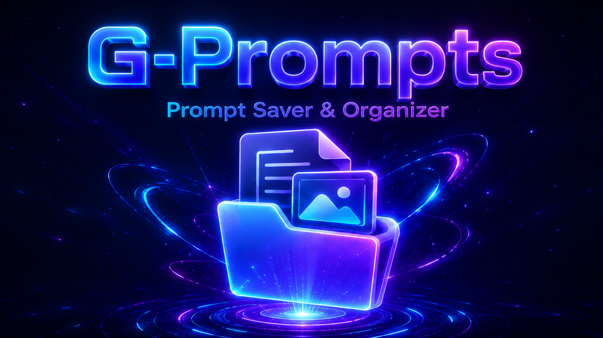
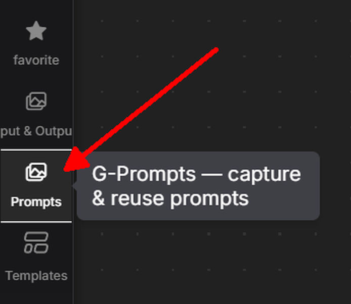
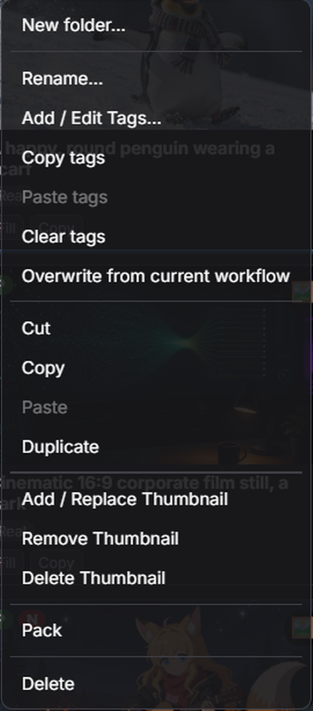
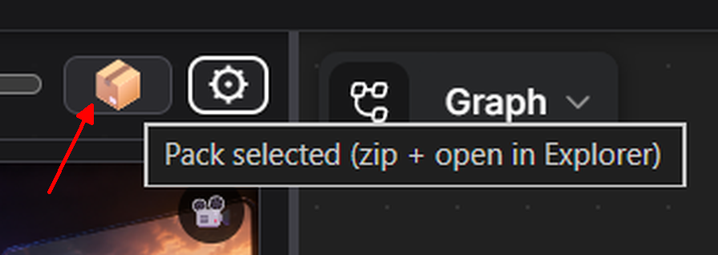
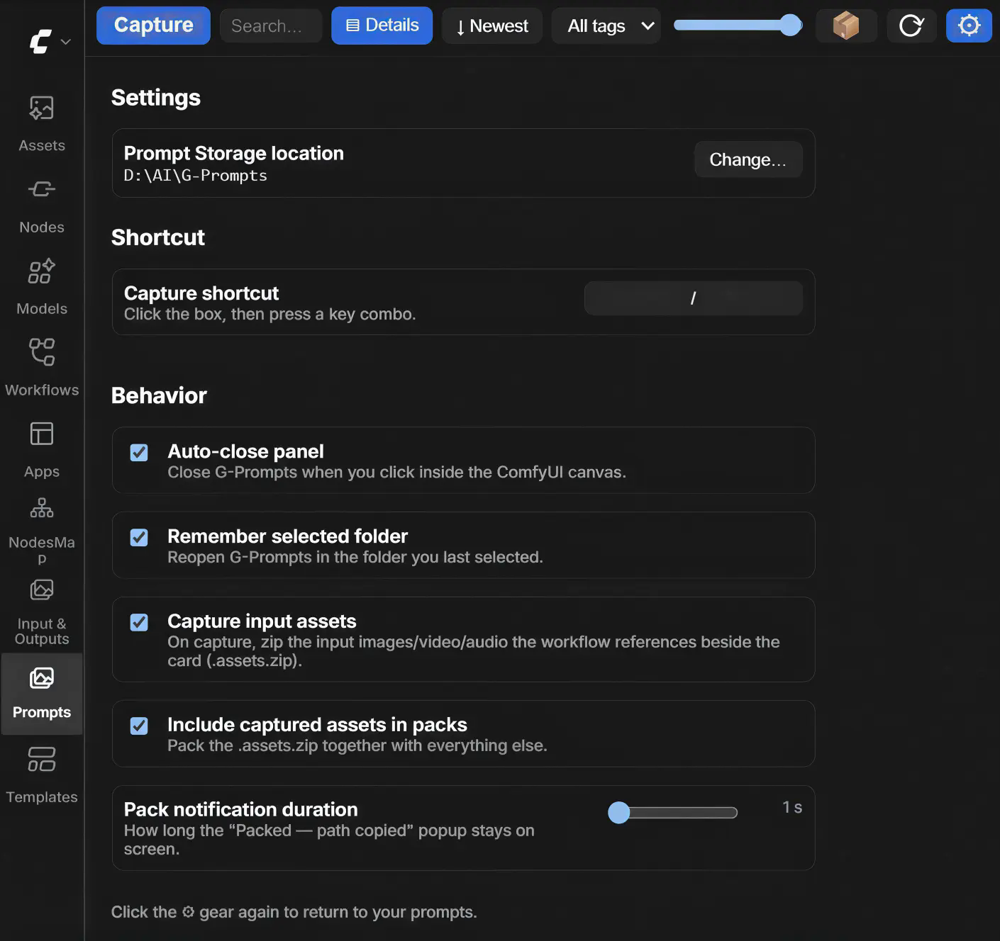

<p align="center">
  
</p>

<h1 align="center">G-Prompts</h1>

<p align="center">
  <strong>Capture the prompt that produced a result, review your library, and feed prompts back into any workflow — right inside ComfyUI.</strong>
</p>

<p align="center">
  
  
  
</p>

---

G-Prompts is a native ComfyUI **sidebar** for building a personal, reusable prompt library. Hit one button and it traces your active workflow to grab the exact positive/negative prompt that made your last image, video, or audio — bundled with a thumbnail of the result and a copy of the workflow itself. Later, browse your library, edit prompts in place, and drop them back onto the canvas.

No graph nodes are added; it's UI + a handful of local server routes. **Your library is just files on disk** in a folder you choose — one card is a small set of sidecar files (`.txt` prompt, `.json` metadata, a thumbnail, and the workflow), so it stays readable, portable, and safe to back up or edit by hand.

## ▶ Walkthrough

<p align="center">
  <a href="https://github.com/AI4VFX/comfyui-gprompts/releases/download/v1.0.0/G-Prompts_Walkthrough.mp4"></a>
  <br><em>▶ Click to watch the walkthrough (~4 min)</em>
</p>

## Install

**ComfyUI Manager (recommended)** — search for **G-Prompts** in the Manager and install, then restart ComfyUI.

**Manual**
```bash
cd ComfyUI/custom_nodes
git clone https://github.com/AI4VFX/comfyui-gprompts.git
```
Restart ComfyUI. The one Python dependency (`Send2Trash`, used for send-to-recycle-bin) installs automatically via `requirements.txt`.

- **ffmpeg** is optional — it's only used to make compact thumbnails/posters for **video** results. Put `ffmpeg` on your `PATH` if you generate video; images and audio don't need it.
- First launch: open the **Prompts** tab and pick a folder to store your library in.

## Getting started

Open the **Prompts** tab in the ComfyUI left sidebar.



On first run you'll be asked to choose a **library folder** — everything G-Prompts saves lives there. That's it; you're ready to capture.

## Features

### ⚡ Capture
Click **Capture** (or press the shortcut, **Alt+Q** by default) and G-Prompts traces your current workflow to find the prompt that feeds generation:

- **Sampler workflows** → reads the sampler's positive/negative conditioning and resolves it back to the original prompt text (skipping enhancement sub-graphs and parameter strings).
- **No-sampler workflows** (LTX, TTS, custom, VLLM) → walks back from the output/save nodes to the prompts actually wired into the result.
- **Selection** → capture exactly the text node(s) you've selected, split into positive/negative by wiring, node title, or sampler branch.

Each capture becomes **one card** holding the positive **and** negative together, plus a thumbnail of the latest result and a copy of the workflow. Captured cards keep the *original* prompt (stable and reproducible), not a runtime-enhanced variant.

### The library


The panel is a grid of cards over a **folders + tags** column, with an editable **detail pane** below.

- **Cards** show the result poster (16:9), a **P/N** badge for which polarities exist, a media-type icon (🖼️ / 📽️ / 🔊 / 📖), the title, tags, and quick **Fill** / **Copy** buttons.
- **Single-click** selects (instant); **double-click the thumbnail** opens the full image/video/audio; **double-click the title** renames in place; **middle-click** spawns both prompt nodes; **drag onto a folder** to move; **drag onto the canvas** to rebuild the original workflow; **right-click** for the full menu.
- The size slider scales the grid; **Search** and the **tag** filter narrow it down.

### Folders & tags
Folders are **real directories** on disk. Tags live in a small registry so you can create empty tags up front and assign later — **drag tags onto cards** (or cards onto a tag) to tag in bulk. Click a tag to filter; the tag pane has its own size and sort.

### Detail pane — edit positive & negative
Toggle **Detail** to open resizable **Positive** and **Negative** editors. Edit the text and **Save**; each block has its own **Fill** and **Copy**. Edits are written straight to the card's files — and a card you edited then **drag back onto the canvas rebuilds the workflow with your edited prompt**, not the original.

### Fill / re-inject
**Fill** pushes a card's prompt into your workflow: with text nodes selected it fills them by polarity (negative-detected node gets the negative, everything else the positive); with nothing selected it spawns fresh prompt nodes. Great for reusing a favourite prompt across new graphs.

### Manage cards
Right-click any card:



Rename, edit/copy/paste/clear **tags**, **Overwrite from current workflow** (re-capture into this card, keeping its title + tags), Cut / Copy / Paste / Duplicate, add / replace / remove / delete the **thumbnail**, **Pack**, and **Delete** (which goes to the OS **Recycle Bin / Trash**, so it's recoverable).

### Pack / export


**Pack** zips the selected card(s) — prompt, metadata, media, and workflow — and reveals the archive in your file manager. Perfect for sharing a prompt + its result + the exact graph that made it.

### Settings


- **Prompt Storage location** — change where your library lives.
- **Capture shortcut** — rebind the capture hotkey (default **Alt+Q**).
- **Auto-close panel** — collapse G-Prompts when you click back into the canvas.

## How it stores things

The filesystem **is** the database. Under your chosen root, each card is a small set of sidecar files sharing one name:

```
<root>/<Folder>/<name>.txt          the positive prompt
<root>/<Folder>/<name>.neg.txt      the negative prompt
<root>/<Folder>/<name>.json         metadata (title, tags, source, type)
<root>/<Folder>/<name>.<ext>        the result media (image / video / audio)
<root>/<Folder>/<name>.thumb.jpg    the 16:9 card poster
<root>/<Folder>/<name>.workflow.json  the workflow, for canvas rebuild
```

Because it's plain files, you can back it up, sync it, or reorganise it in your file manager and G-Prompts will follow along.

## Compatibility

- ComfyUI with a recent frontend (subgraph-flattened capture is tested on frontend 1.45+).
- Works the same whether ComfyUI runs locally or on a remote/headless server (all storage is server-side; the UI is a normal sidebar).

## License

MIT © Greg Glezakos (AI4VFX). See [LICENSE](LICENSE).
