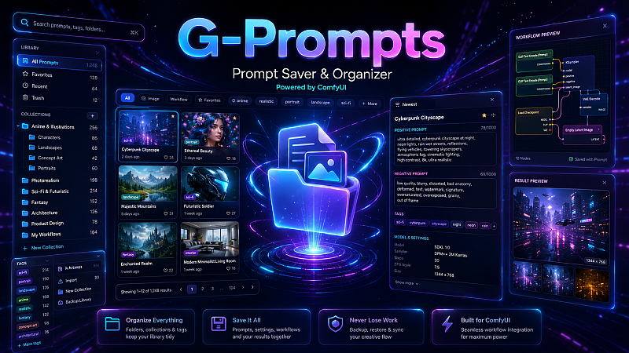
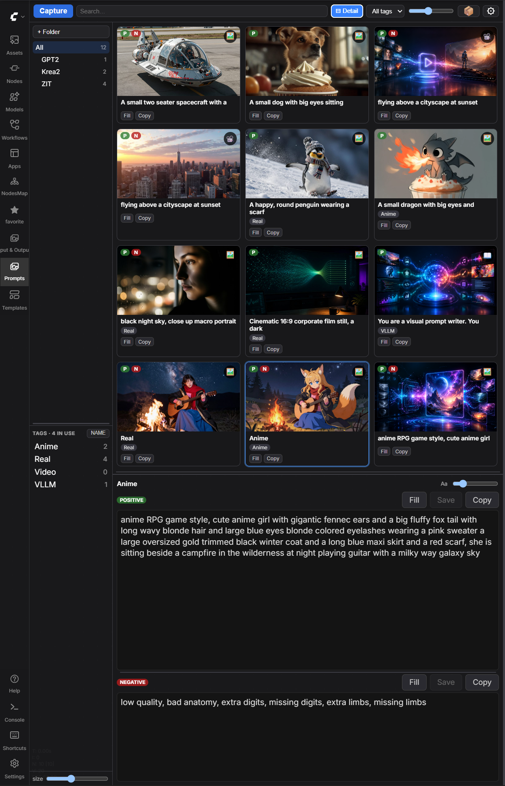

<p align="center">
  
</p>

<h1 align="center">G-Prompts</h1>

<p align="center">
  <strong>Capture the prompt that produced a result, review your library, and feed prompts back into any workflow — right inside ComfyUI.</strong>
</p>

<p align="center">
  
  
  
</p>

---

G-Prompts is a native ComfyUI **sidebar** for building a personal, reusable prompt library. Hit one button and it traces your active workflow to grab the exact positive/negative prompt that made your last image, video, or audio — bundled with a thumbnail of the result and a copy of the workflow itself. Later, browse your library, edit prompts in place, and drop them back onto the canvas.

No graph nodes are added; it's UI + a handful of local server routes. **Your library is just files on disk** in a folder you choose — one card is a small set of sidecar files (`.txt` prompt, `.json` metadata, a thumbnail, and the workflow), so it stays readable, portable, and safe to back up or edit by hand.

## ▶ Walkthrough

<p align="center">
  <a href="https://github.com/AI4VFX/comfyui-gprompts/releases/download/v1.0.0/G-Prompts_Walkthrough.mp4"></a>
  <br><em>▶ Download and watch offline (~4 min walkthrough · 56 MB)</em>
</p>

Prefer short clips? Jump to the **[feature demos](#-feature-demos)** below — fifteen 10-second videos, one per feature.

## Install

**ComfyUI Manager (recommended)** — search for **G-Prompts** in the Manager and install, then restart ComfyUI.

**Manual**
```bash
cd ComfyUI/custom_nodes
git clone https://github.com/AI4VFX/comfyui-gprompts.git
```
Restart ComfyUI. **No Python dependencies** — G-Prompts runs on the standard library alone.

- **ffmpeg** is optional — it's only used to make compact thumbnails/posters for **video** results. Put `ffmpeg` on your `PATH` if you generate video; images and audio don't need it.
- First launch: open the **Prompts** tab and pick a folder to store your library in.

## What's new in 1.3.0

- Cards with captured input assets now put them back when you load the workflow. Drag the card onto the canvas and any input file that's missing from ComfyUI's input folder is copied out of the card's `.assets.zip` first, so the Load Image / Video / Audio nodes aren't empty. Files that are already there are never overwritten: if one has the same name but different content you get a warning and yours is kept. There's a switch for it in Settings (*Restore missing input assets*, on by default).

## What's new in 1.2.0

- The folder/tag column can be resized. Drag the line between it and the cards.
- Trash has its own area at the bottom of the folder pane now, so it stays in view with a long folder list. Drag the line above it to make it taller, or hide it with the 🗑 button at the bottom of the pane (click again to bring it back).
- The folder list has a size slider at the bottom, same as the one under the tags.

## What's new in 1.1.1

- **The default thumbnails ship with the node.** Cards that have no result poster — audio captures, prompts saved before a render, anything whose thumbnail you've hidden — fall back to artwork for the four categories (Image / Video / Audio / Other). Until now that art lived only in my own library folder, so a fresh install fell through to a flat coloured tile with a type label on it. The four images are part of the package now and a new install looks right on first launch. Your own art still wins: drop `Generic-Image.png`, `Generic-Video.png`, `Generic-Audio.png` or `Generic-Other.png` into the `defaults` folder in your library root and G-Prompts uses those instead.

## What's new in 1.1.0

- **Non-destructive delete** — "Delete" now moves cards into a **Trash** folder inside your library (mirrored hierarchy, one-click **Restore**, size badge). G-Prompts ships with **zero deletion code**: nothing it does can permanently destroy a file. You empty the Trash yourself, in your file manager, when *you* decide.
- **Capture input assets** — optionally zip the input images/video/audio your workflow references beside the card (`.assets.zip`), and include them in Packs. A captured card can now carry *everything* needed to reproduce the result.
- **Remember selected folder** — reopen the panel in the folder you last used.
- **Hide / unhide a card's custom thumbnail**, with an "!" badge when hidden.
- **Per-card default thumbnail** — choose which built-in placeholder (Image / Video / Audio / Other) a card shows.
- **Card sorting** — toolbar button cycles ↓ Newest → ↑ Oldest → A→Z → Z→A.
- **⟳ Refresh** toolbar button — rescan the library so files you dropped in by hand get picked up.
- **Pack copies the path** — packing now puts the zip's full path on your clipboard and shows a toast (duration configurable in Settings).
- **Details pane on by default** for fresh installs; new "A" (assets) badge on cards.

## Getting started

Open the **Prompts** tab in the ComfyUI left sidebar.


On first run you'll be asked to choose a **library folder** — everything G-Prompts saves lives there. That's it; you're ready to capture.

## Features

### ⚡ Capture
Click **Capture** (or press the shortcut, **Alt+Q** by default) and G-Prompts traces your current workflow to find the prompt that feeds generation:

- **Sampler workflows** → reads the sampler's positive/negative conditioning and resolves it back to the original prompt text (skipping enhancement sub-graphs and parameter strings).
- **No-sampler workflows** (LTX, TTS, custom, VLLM) → walks back from the output/save nodes to the prompts actually wired into the result.
- **Selection** → capture exactly the text node(s) you've selected, split into positive/negative by wiring, node title, or sampler branch.

Each capture becomes **one card** holding the positive **and** negative together, plus a thumbnail of the latest result and a copy of the workflow. Captured cards keep the *original* prompt (stable and reproducible), not a runtime-enhanced variant. With **Capture input assets** enabled, the input media the workflow references is zipped beside the card too.

### The library


The panel is a grid of cards over a **folders + tags** column, with an editable **detail pane** below.

- **Cards** show the result poster (16:9), a **P/N** badge for which polarities exist, an **"A"** badge when input assets are attached, an **"!"** badge when a custom thumbnail is hidden, a media-type icon (🖼️ / 📽️ / 🔊 / 📖), the title, tags, and quick **Fill** / **Copy** buttons.
- **Single-click** selects (instant); **double-click the thumbnail** opens the full image/video/audio; **double-click the title** renames in place; **middle-click** spawns both prompt nodes; **drag onto a folder** to move; **drag onto the canvas** to rebuild the original workflow; **right-click** for the full menu.
- The toolbar has **Search**, the **▤ Details** toggle, a **sort** button (↓ Newest → ↑ Oldest → A→Z → Z→A), a **tag filter**, a size slider for the grid, a **📦 Pack** button, and **⟳ Refresh** to rescan the library.

### Folders & tags
Folders are **real directories** on disk. Tags live in a small registry so you can create empty tags up front and assign later — **drag tags onto cards** (or cards onto a tag) to tag in bulk. Click a tag to filter; the tag pane has its own size and sort. The folder list has its own size slider too, and the 🗑 button next to it hides or shows the Trash area. Drag the column's right edge to make it wider. G-Prompts remembers the folder you left off in and reopens there (Settings → *Remember selected folder*).

### Detail pane — edit positive & negative
Toggle **▤ Details** to open resizable **Positive** and **Negative** editors (on by default on fresh installs). Edit the text and **Save**; each block has its own **Fill** and **Copy**. Edits are written straight to the card's files — and a card you edited then **drag back onto the canvas rebuilds the workflow with your edited prompt**, not the original.

### Fill / re-inject
**Fill** pushes a card's prompt into your workflow: with text nodes selected it fills them by polarity (negative-detected node gets the negative, everything else the positive); with nothing selected it spawns fresh prompt nodes. Great for reusing a favourite prompt across new graphs.

### Manage cards
Right-click any card:


Rename, edit/copy/paste/clear **tags**, **Overwrite from current workflow** (re-capture into this card, keeping its title + tags), Cut / Copy / Paste / Duplicate, add / replace / remove / hide the **thumbnail**, pick the **default thumbnail** style, **Pack**, and **Move to Trash**.

### 🗑 Trash — nothing is ever destroyed
Deleting a card, thumbnail, or folder **moves it to a `Trash/` folder inside your library**, keeping its original sub-folder structure. The pinned **Trash** row in the folder pane shows how much space it's using; open it and right-click any card to **Restore** it to where it came from. G-Prompts contains **no file-deletion code at all** — emptying the Trash is something you do yourself in your file manager, when you're sure.

### Pack / export


**Pack** zips the selected card(s) — prompt, metadata, media, workflow, and (optionally) captured input assets — and **copies the archive's path to your clipboard**, with a toast to confirm. Perfect for sharing a prompt + its result + the exact graph that made it.

### Settings


- **Prompt Storage location** — change where your library lives.
- **Capture shortcut** — rebind the capture hotkey (default **Alt+Q**).
- **Auto-close panel** — collapse G-Prompts when you click back into the canvas.
- **Remember selected folder** — reopen in the folder you last selected.
- **Capture input assets** — on capture, zip the workflow's referenced input media beside the card (`.assets.zip`).
- **Include captured assets in packs** — bundle the `.assets.zip` into Packs.
- **Restore missing input assets** — when a card is dropped on the canvas, copy its captured input files back into ComfyUI's input folder if they're missing. Existing files are never overwritten.
- **Pack notification duration** — how long the "Packed — path copied" toast stays up (1–15 s).

## 🎬 Feature demos

Fifteen ~10-second clips, one per feature.

### Auto-close panel
Click back into the canvas and the panel gets out of your way — one toggle in Settings.

https://github.com/user-attachments/assets/0c104062-03b1-4dc2-af35-f99e6d02e351

### Set the storage location
Pick the folder your library lives in — every card is plain files on disk, ready to back up or sync.

https://github.com/user-attachments/assets/db0d2afc-2f65-4b5a-8195-00b271f81a20

### Capturing prompt cards
One click grabs the exact positive/negative prompt behind your last result — with a thumbnail and a copy of the workflow.

https://github.com/user-attachments/assets/05a552ee-0c36-4413-9817-76ec934eb3aa

### Capture any workflow
No sampler? No problem — LTX, TTS, and custom graphs are traced back from their output nodes to the prompts that made the result.

https://github.com/user-attachments/assets/09861c0e-bdbe-4d80-8d9b-ea8c7daa361b

### Capture videos, with previews
Video results get a compact poster (via ffmpeg) and play right on the card — double-click to open the full clip.

https://github.com/user-attachments/assets/ac93890a-ea6f-457a-bca8-270d1b4141e8

### Default thumbnails
Hide a card's custom thumbnail or pick which built-in placeholder (Image / Video / Audio / Other) it shows. Replace the art by dropping your own `Generic-<Category>.png` into the `defaults` folder in your library root.

https://github.com/user-attachments/assets/cfde5004-2cc1-45e7-943c-87f305c18fab

### Create folders
Folders are real directories on disk — make them in the panel, drag cards in to organise.

https://github.com/user-attachments/assets/930a6d03-45bf-46eb-bd76-9cdb834b03e9

### Create tags
Create tags up front, drag them onto cards (or cards onto tags) to assign in bulk, click to filter.

https://github.com/user-attachments/assets/3d0cc802-c5ab-41c9-9328-8c86546bc472

### Drag & drop into the canvas
Drop a card onto the canvas and the workflow that produced it is rebuilt — with your edits, if you made any.

https://github.com/user-attachments/assets/8aea8e43-5b1b-43af-9e49-801cce46054b

### Fill selected nodes
Select your text node(s) and hit Fill — the positive and negative land in the right nodes automatically, by polarity.

https://github.com/user-attachments/assets/96ae042c-4cdf-4f0f-9ee1-107337827194

### Fill with no selection
Nothing selected? Fill spawns fresh prompt nodes ready to wire into any graph.

https://github.com/user-attachments/assets/7275cb8b-fda3-4f17-ba6f-b17dbb52edcf

### Duplicate, edit & overwrite cards
Duplicate a card, edit its positive/negative in the detail pane, or overwrite it from the current workflow while keeping its title and tags.

https://github.com/user-attachments/assets/ec78f88d-2cf8-44b1-ab98-4191e62a6d14

### UI controls
Search, the ▤ Details toggle, sort cycling, tag filtering, the grid size slider, and ⟳ Refresh — a tour of the toolbar.

https://github.com/user-attachments/assets/4cdd93fb-5830-468b-afed-47289efb331a

### Non-destructive delete
"Delete" just moves the card to your library's Trash folder — restore it any time; G-Prompts never destroys a file.

https://github.com/user-attachments/assets/ac1688f5-2c64-4335-87ad-9f86490594ff

### Pack complete cards for sharing
Pack zips prompt + metadata + media + workflow (+ captured input assets) into one archive and copies its path to your clipboard.

https://github.com/user-attachments/assets/af4896f3-17c2-4749-9667-52438940be99

## How it stores things

The filesystem **is** the database. Under your chosen root, each card is a small set of sidecar files sharing one name:

```
<root>/<Folder>/<name>.txt            the positive prompt
<root>/<Folder>/<name>.neg.txt        the negative prompt
<root>/<Folder>/<name>.json           metadata (title, tags, source, type)
<root>/<Folder>/<name>.<ext>          the result media (image / video / audio)
<root>/<Folder>/<name>.thumb.jpg      the 16:9 card poster
<root>/<Folder>/<name>.workflow.json  the workflow, for canvas rebuild
<root>/<Folder>/<name>.assets.zip     captured input assets (optional)
<root>/Trash/…                        trashed cards, original hierarchy preserved
<root>/defaults/Generic-Image.png     your own default thumbnail (optional, overrides the packaged one)
<root>/defaults/Generic-Video.png     …same for Video, Audio and Other (.png / .jpg / .webp)
```

Because it's plain files, you can back it up, sync it, or reorganise it in your file manager and G-Prompts will follow along.

The `defaults` folder starts empty. Anything you put there overrides the artwork that ships with the node, per category — handy if you'd rather your cards showed your own placeholder art. Delete a file and the packaged one comes back.

## Compatibility

- ComfyUI with a recent frontend (subgraph-flattened capture is tested on frontend 1.45+).
- Works the same whether ComfyUI runs locally or on a remote/headless server (all storage is server-side; the UI is a normal sidebar).

## License

MIT © Greg Glezakos (AI4VFX). See [LICENSE](LICENSE).
